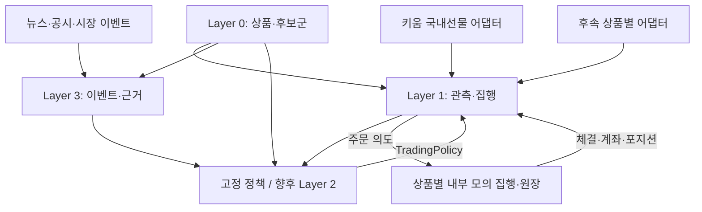

# Phase 0.1: 국내 선물 우선의 다중 상품 구축 범위

문서 버전: 0.2.0 · 갱신일: 2026-11-04 (Asia/Seoul) · 관련 작업: [#2](https://github.com/TheMostEvident/quant-trading-system/issues/2)

## 1. 확정된 목표와 검증 순서

| 구분 | 내용 | 확정 수준 |
| --- | --- | --- |
| 거래 대상 | 국내 주식 현물·국내 선물·해외 선물·크립토 현물 | 사용자 선택 |
| 첫 연결 | 국내 선물의 수집·모의매매 | 사용자 선택 |
| 서비스 | 키움증권·바이낸스 우선 검토 | 사용자 선호; 계좌/API 접근 확인 아님 |
| Layer 순서 | Layer 1 → Layer 3 → Layer 0 → Layer 2 | 사용자 지시 |
| Layer 2 | 금융수학·확률제어 등 학습·연구 후 마지막 구현 | 사용자 지시 |
| 현재 작업 | 범위·입출력 계약·비교·결정 문서 | 코드 작성 보류 유지 |
| 국내 선물 최초 상품 | OpenAPI+에서 공식 지원하는 코스피200 선물 계열 우선 검증 | 설계 제안; 계약·월물은 아직 미선정 |
| 나머지 상품 연결 순서 | 국내 현물·해외 선물·크립토 현물 | 미결정; 목표 범위에서 제외하지 않음 |

국내 개별주식선물의 API 지원은 별도 확인한다. 코스피200 선물 지원 안내만으로 모든 국내 선물이 지원된다고 표시하지 않는다. API가 옵션을 제공하더라도 현재 프로젝트 범위가 옵션까지 자동 확대되지는 않는다.

v0.1의 현물 매수 중심·KIS 우선 검토는 이번 사용자 선택으로 대체되었다.

## 2. 목표 범위와 첫 검증 범위

첫 Layer 1 검증은 **국내 선물 한정 seed, 양방향 포지션, 내부 모의 집행**으로 수행한다. 최초 계약의 호가단위·승수·거래 세션·만기·증거금 규칙을 확인한 뒤 그 계약의 피드를 연결한다.

공통 규격에는 국내 현물·해외 선물·크립토 현물의 확장 지점을 둔다. 각 상품의 실제 어댑터·원장·운영 검증을 완료하기 전에는 지원 완료로 표시하지 않는다. 나머지 시장의 연결 시기·순서는 별도 계획 항목이며 국내 선물의 초기 검증에 다른 거래소 계좌를 선행 조건으로 두지 않는다.

| 상품 | 수량 | 포지션·장부의 핵심 차이 |
| --- | --- | --- |
| 국내 주식 현물 | 주·수량 단위 규칙 | 보유분 매도, 실제 매매대금·수수료·세금 |
| 국내 선물 | 정수 계약·계약별 승수 | 롱/숏, 증거금·미결제약정·정산·만기·롤오버 |
| 해외 선물 | 상품별 계약·정산통화 | 위 항목과 외화·시장별 세션·거래일·서머타임 |
| 크립토 현물 | 기준자산 소수 수량 | 거래쌍·수량/가격 필터·자산별 잔고·수수료 자산 |

선물 주문 때 명목가치 전액을 현물 매수대금처럼 현금에서 차감하지 않는다. 담보·증거금·비용·실현 및 미실현 손익은 따로 관리한다. 바이낸스 현물에는 현물 원장을 적용하고 증거금 선물 원장을 적용하지 않는다.

## 3. 논리 구조와 API 경계

| 경계 | 역할 |
| --- | --- |
| 키움 국내 선물 | OpenAPI+ Windows COM/OCX 경로를 우선 검증; 메타데이터·시세·체결·대조 이벤트 정규화 |
| 키움 해외 선물 | 별도 OpenAPI-W 경로의 어댑터·계좌·상품 마스터 검증 |
| 국내 현물 | OpenAPI+ 또는 REST 중 필요한 기능·운영 조건에 맞춰 후속 선택 |
| 바이낸스 현물 | 공식 Spot REST/WebSocket과 자산·필터·호가 동기화 규칙을 별도 정규화 |
| 공통 엔진 | 공급자 필드·COM 핸들에 의존하지 않는 계약·신호·주문 상태·위험 검사 |
| Layer 3 | 주문 루프와 분리된 비동기 수집·평가·저장; 상품·기초자산별 근거 연결 |

첫 국내 선물 어댑터는 Windows에서 실행하는 경계를 둔다. 공통 엔진·연구·Layer 3까지 전부 Windows에 묶지 않는다. COM 이벤트 루프·실제 모듈 비트수·호환 런타임·재접속 방식은 #3–4에서 확인한다. 모든 경로를 하나의 REST 클라이언트로 묶지 않는다.

## 4. Layer 2 없이 진행하는 입력과 책임

- seed InstrumentSpec은 해당 선물 계약·승수·세션·증거금·정산 규칙의 유효 버전을 제공한다.
- seed 자산 연결은 선물 계약 → 기초자산/지수/업종, 기업·거래쌍을 연결한다.
- 고정 정책은 signed 목표 총 계약 수와 진입·유지·청산 조건, 유효기간을 제공한다.
- 집행기는 정책 목표와 실제 보유·미체결·계좌 증거금을 함께 확인한다.
- Layer 3는 EventPacket과 근거를 제공하며 Noul을 점프 확률이나 매매 승률로 치환하지 않는다.
- Phase 3에서 seed를 Layer 0로, Phase 5에서 고정 정책을 Layer 2로 교체한다.
- 실제 계좌 상태를 합성하거나 선물 증거금을 잔고의 임의 고정 배수로 추정하지 않는다. 내부 모의의 단순화 가정은 별도로 표시한다.

## 5. 실행 모드

| 모드 | 입력 | 주문·원장 |
| --- | --- | --- |
| SYNTHETIC_REPLAY | 합성 관측·상품 규칙 | 내부 상품별 모의 |
| RECORDED_REPLAY | 원래 이용 가능 시점의 저장 자료 | 내부 상품별 모의 |
| SHADOW | 현재 관측·이벤트 | 기록 또는 내부 모의; 실계좌 주문 없음 |

브로커 모의투자 서버와 내부 모의는 구별한다. 현재 선택은 연결 대상과 개발 우선순위를 확정하며, 계좌 로그인·서비스 신청·자금 주문을 실행하는 지시는 아니다.

실행마다 원천·계약·정책·시장 상태·시계·비용·증거금 규칙을 버전으로 보존한다. 장 종료·야간 세션·휴장·서머타임·유지보수는 상품별 달력으로 처리한다. 국내 현물 장시간을 선물이나 크립토에 공통 적용하지 않는다.

## 6. 초기 완료 기준과 미결정 항목

| 항목 | 기준/후속 작업 |
| --- | --- |
| 문서 계약 | 기존 6종에 공통 AccountState를 추가한 v0.2; 실제 기능 구현 아님 |
| 국내 선물 상품 | #4에서 계약·지원 범위·수신 필드·계좌/모의 환경 확인 |
| Runtime·원천 저장·IPC | #3에서 COM 경계와 휴대 가능한 공통 기반 구체화 |
| 모의 원장 | #7–9에서 양방향·승수·증거금·정산·만기·중복 체결 검증 |
| 해외 선물·국내 현물·크립토 현물 | 후속 연결 순서·심볼 미정; 최초 국내 선물 검증에 종속시켜 목표를 누락하지 않음 |
| Layer 0 전체 소스 | Phase 3.1; 거래소·브로커 피드와 공식 배경 자료를 구별 |
| 최종 임계치·사이징·보유시간 | Layer 2 연구와 실제 비용·지연 결과로 선정 |

공식 경로와 선택 근거는 [source-evaluation.md](source-evaluation.md), 계약은 [contracts-v0.2.md](contracts-v0.2.md), 변경 이력은 [decisions.md](decisions.md)를 따른다.
