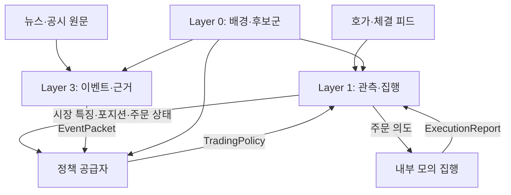

# Phase 0.1: 구축 범위와 구조

문서 버전: 0.1.0 · 작성일: 2026-11-03 (Asia/Seoul) · 관련 작업: [#2](https://github.com/TheMostEvident/quant-trading-system/issues/2)

## 1. 목적과 상태

Layer 1·3을 먼저 만들고, Layer 0를 연결한 뒤, 수학 학습·연구를 마친 Layer 2를 마지막에 구현한다. 이번 작업은 설계 문서 작성이며 실행 코드나 실제 계좌 연결을 포함하지 않는다.

v0.1의 첫 검증 범위는 국내 현물의 매수·보유·매도, 원천 기록, 리플레이와 내부 모의 집행으로 둔다. 이는 선택 질문에 별도 응답이 없는 상태에서 진행하기 위한 **작업 가정**이며 사용자가 상품이나 증권사를 확정했다고 해석하지 않는다. 선물·숏은 계약에 확장 지점을 남기고 초기 지원 기능으로 표시하지 않는다.

## 2. 사용자 지시와 작업 가정

| 구분 | 내용 |
| --- | --- |
| 확정 지시 | 구축 순서: Layer 1 → Layer 3 → Layer 0 → Layer 2 |
| 확정 지시 | Layer 2는 금융수학·확률제어 등 학습·연구 이후 구현 |
| 확정 지시 | 코드 작성에 앞서 단계와 범위를 정함 |
| v0.1 작업 가정 | 국내 현물·KRW, 매수/보유/보유분 매도, 공매도·차입·레버리지 미지원 |
| v0.1 작업 가정 | 거래 대상은 작은 수동 seed 목록으로 시작하고 Phase 3의 후보군으로 교체 |
| v0.1 작업 가정 | 초기 종목별 목표 수량은 고정 정책으로 지정하며 최적 베팅 결과로 해석하지 않음 |
| 비교 후 권고 | 첫 실시간 수집 어댑터의 우선 검토 후보는 KIS, 대안은 키움 REST |
| 후속 검증 | 계좌/API 권한, 수신 필드·호가 깊이·구독 한도·시각 정밀도·재접속 방식 |

시장·상품·API 비교와 근거는 [source-evaluation.md](source-evaluation.md), 변경 이력은 [decisions.md](decisions.md)를 따른다.

## 3. 초기 범위

| 포함 | 완료로 간주하지 않는 것 |
| --- | --- |
| 원천 가격·호가·체결 및 이벤트의 저장·정규화·재생 | 거래소 전체 주문 이벤트나 과거 대기열을 완전히 복원했다는 주장 |
| OBI·관측 OFI·EMA·변화율과 필터의 재현 | 지표가 비용 이후 수익을 예측한다는 실증 |
| 고정 정책과 모의 주문 상태·체결·현금 원장 | 최종 동적 임계치·최적 사이징·실계좌 운용 |
| 원문·표·문단 근거, 기업·이벤트 연결, Jev 구조화 판단 | AI의 선택 확률을 매매 승률이나 가격점프 확률로 치환 |
| 메시지 규격과 교체 가능한 어댑터 경계 | 미확인 API·상품을 이미 지원한다는 표시 |

관측 대상 세션은 초기에는 명시적으로 지정한 연속매매 구간이다. 거래일·세션·호가 규칙은 seed 메타데이터 또는 확인된 공급자 정보로 제공하며 달력 날짜만으로 거래 가능 상태를 추정하지 않는다. 단일가·중단·상태 불명은 기록하되 그 상태에서 신규 진입하지 않는다. 실제 세션 시각과 휴장일은 연결 검증 때 확인한다.

## 4. 논리 구조

Phase 1·2의 정책 공급자는 고정 정책이며 후보군은 seed이다. Phase 3에서 seed를 Layer 0로 교체하고 Phase 5에서 고정 정책 공급자를 Layer 2로 교체한다. 논리 경계가 프로세스·클라우드 서비스의 개수를 정하지는 않는다.

| 구성요소 | 입력 | 출력·소유 책임 |
| --- | --- | --- |
| Layer 1 특징 계산 | MarketSnapshot | 시점이 보존된 시장 특징; 주문·포지션 상태를 직접 변경하지 않음 |
| Layer 1 집행·원장 | TradingPolicy, 시장 관측, ExecutionReport | 주문 의도, PositionState, 실제 체결·예약 수량 관리 |
| Layer 3 | 원문, seed/Layer 0 기업 매핑 | EventPacket, 근거·정정·모델 응답 이력 |
| Layer 0 | Phase 3에서 확정하는 정형 자료 | UniverseSnapshot, 시점별 InstrumentSpec 및 배경 특징 |
| 고정 정책 공급자 / 향후 Layer 2 | 유효 관측·포지션·미체결·이벤트·후보군 | 동일한 TradingPolicy 계약 |
| 공통 기반 | 원천과 파생 메시지 | 식별자·버전·시간·계보·재생 순서; 구현은 #3 |

전역 위험 한도, 주문·잔고 대조와 데이터 신선도 감시는 집행 경계에서 별도로 적용한다. 정책이 더 큰 목표를 제시해도 실제 허용 한도를 초과해 발주하지 않는다.

## 5. Layer 2 없이 먼저 검증하는 방법

1. 합성 또는 실제 수집 자료임을 표시한 seed 종목·기업 목록을 제공한다.
2. 상품별 최소 정보인 InstrumentSpec을 직접 제공한다. 미확인 필드는 null이며 해당 기능은 허용하지 않는다.
3. 고정 정책으로 매수·보유·청산 조건, 목표 수량과 유효기간을 주입한다.
4. Layer 1은 정책을 수신해도 주문 접수·실제 체결 이전에는 보유 수량을 바꾸지 않는다.
5. Layer 3는 이벤트·근거를 저장·전달한다. Phase 2 완료에 뉴스의 수익성 입증이나 임시 뉴스 매매 규칙을 요구하지 않는다.
6. seed → Layer 0, 고정 정책 → Layer 2 교체 후에도 원천과 메시지 규격을 유지한다.

seed는 Layer 0의 자료 수집·선별 모형이 아니다. 지원 자산·세션·유효기간이 명시된 테스트 입력이며 실제 종목을 선정할 때 추천 목록으로 취급하지 않는다.

## 6. 실행 모드와 경계

| 모드 | 시장·문서 입력 | 주문 처리 |
| --- | --- | --- |
| SYNTHETIC_REPLAY | 명시적으로 합성한 고정 fixture | 내부 모의 집행 |
| RECORDED_REPLAY | 수집 당시 시간·버전을 보존한 자료 | 내부 모의 집행 |
| SHADOW | 현재 관측 및 이벤트 | 기록만 하거나 별도 내부 모의 집행; 실제 주문 없음 |

브로커 모의투자 서버는 내부 모의 집행과 다른 환경이다. 계좌 연동 여부·체결 모형 차이를 후속 Issue에서 검증하며, 이 문서의 모의 실행이라는 표현만으로 자동 연결하지 않는다. 실행 모드는 run_id에 고정하고 실제·합성·모의 입력을 섞은 결과를 하나의 실측 성과로 집계하지 않는다.

## 7. 초기 환경 선택

| 항목 | v0.1 방향 | 구체화 시점 |
| --- | --- | --- |
| 연구·어댑터 언어 | Python을 우선 검토; 계약은 언어 독립 | #3에서 버전·의존성 확정 |
| 고속 계산 경로 | C++ 전환 가능 경계 유지 | 실제 처리 지연 측정 후 판단 |
| 운영체제 | REST/WebSocket 경로에서 Windows·Linux·macOS 이식성 추구 | 선택 API 연결 시험 |
| 원천 저장·조회 | 원문/원시 메시지와 파생값·정정 이력 분리 | #3에서 저장 형식·DB 결정 |
| 메시지 전달 | 최소 한 번 전달을 허용하고 식별자로 중복 처리 방지 | #3에서 실행 방식 결정 |
| Layer 3 실행 | 큐 또는 동등한 비동기 경계 | #14에서 배포·복구 결정 |
| 클라우드 | 자료 수집·분석의 상시 운영과 처리량 확장에 사용 | 측정·예산에 따라 결정 |

구독 종목 수, 호가 깊이, 지연 상한, 보유시간, 수수료·세율·슬리피지 값은 실제 경로와 가정을 기록한 뒤 정한다. 지금 특정 수치를 최적값이나 현재 거래조건으로 고정하지 않는다.

## 8. Issue #2 산출물과 다음 단계

- 최소 6개 메시지의 필드·시간·단위·유효성·예시는 [contracts-v0.1.md](contracts-v0.1.md)에 정의한다.
- 상품/API 선택의 확정 수준을 기록하고 실제 접근 확인을 Phase 1의 진입 확인 항목으로 둔다.
- 문서 검토 후 #3에서 공통 데이터 기반의 구체 설계·구현 범위를 정한다.
- 자료 공급자의 계좌·토큰·키·비공개 문서 원문은 이 설계 문서에 포함하지 않는다.
